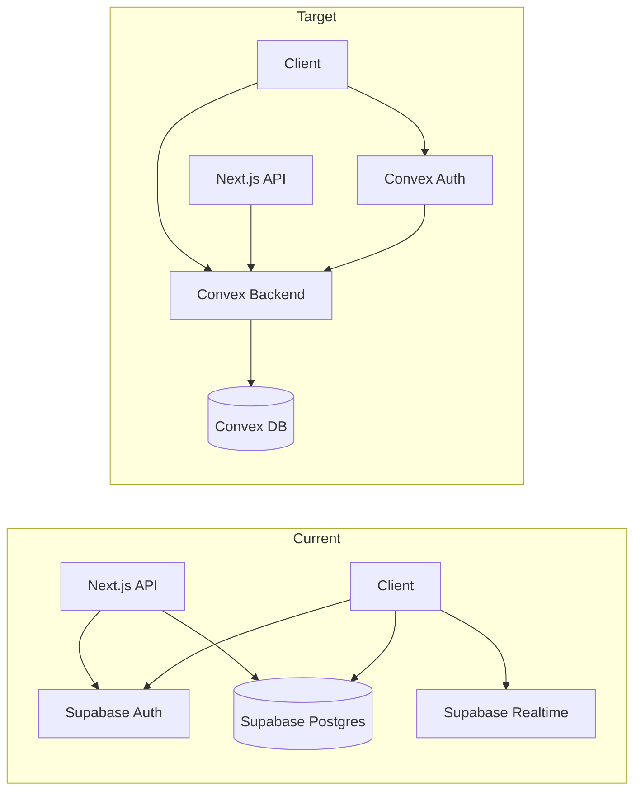

# Supabase to Convex migration plan

## Current architecture (summary)

- **Data**: Supabase Postgres — `profiles`, `api_tokens`, `boards`, `goals`, `records` with RLS and triggers (e.g. `current_amount` on goals, `public_slug` on boards, profile + default board on signup).
- **Auth**: Supabase Auth — magic link + Google OAuth; session via cookies; `getUser()` in server components and `getSession()` / `onAuthStateChange` on client.
- **Realtime**: Supabase Realtime — Postgres change streams for goals (single goal and board goals) in [use-realtime-goal.ts](src/lib/hooks/use-realtime-goal.ts), [goal-widget.tsx](src/components/embed/goal-widget.tsx), [goals-list.tsx](src/components/dashboard/goals-list.tsx), [board-view.tsx](src/components/public/board-view.tsx).
- **API**: Next.js API routes under `/api/v1/goals`, `/api/tokens` — Bearer token auth via [lib/api/auth.ts](src/lib/api/auth.ts) (hash lookup in `api_tokens`); rate limiting (Redis) and Stripe checkout/webhook/payment-success all use Supabase for user and profile.

## Target architecture

- **Data**: Convex schema and functions; no RLS — access control inside Convex queries/mutations using `ctx.auth`.
- **Auth**: Convex Auth for Next.js (OAuth + magic link). Identity lives in Convex; app uses `useConvexAuth()` and server uses `getToken()` / Convex Auth server helpers for protected routes.
- **Realtime**: Convex reactive `useQuery` (no separate realtime hooks).
- **API**: Either Convex HTTP router for `/api/v1/*` and token validation inside HTTP actions, or keep Next.js API routes that call Convex (e.g. via `fetch` to Convex HTTP or Convex client). Recommendation: Convex HTTP router for v1 + one Next.js route for token creation (or Convex HTTP for that too) so all token/profile/board/goal/record reads and writes go through Convex.

## 1. Convex project setup

- Install Convex: `npx convex dev` (and add `convex` dependency).
- Add Convex provider in root layout (or auth layout) so `useQuery`/`useMutation` and Convex Auth are available everywhere. Use Convex Auth Next.js provider from `@convex-dev/auth` (or the official Convex Auth package for Next.js).
- Environment: `CONVEX_DEPLOYMENT`, `NEXT_PUBLIC_CONVEX_URL`; keep existing Stripe and Redis env vars for payments and rate limiting.

## 2. Schema and data model

Define in [convex/schema.ts](convex/schema.ts) (new):

- **profiles**: `userId` (string, from Convex Auth identity id or email), `name`, `avatarUrl`, `paymentProvider`, `paymentCustomerId`, `hasPaid`, `timezone`, plus `_creationTime`. Index by `userId` for lookups.
- **api_tokens**: `userId`, `name`, `hashedToken`; index by `hashedToken` for auth.
- **boards**: `userId`, `name`, `isPublic`, `publicSlug` (optional), `theme`. Indexes: `by_userId`, `by_publicSlug` (for public slug lookup when `isPublic`).
- **goals**: `boardId`, `userId`, `embedId` (unique), `name`, `targetAmount`, `currentAmount`, `deadline`, `recurrence`, `format`, `color`, `sortOrder`. Indexes: `by_boardId_sortOrder`, `by_userId`, `by_embedId`.
- **records**: `goalId`, `userId`, `amount`, `description`, `timestamp`. Index: `by_goalId_timestamp`.
- **pending_payments** (new): `email`, `stripeCustomerId`, `paymentProvider`, `completedAt` — used by payment-success and webhook to mark users as paid on first sign-in when no Convex user exists yet.

Use Convex validators (`v.object`, `v.string()`, etc.) and table names without underscores to match Convex style (e.g. `userId`, `boardId`). Map existing Supabase snake_case fields to camelCase in the schema.

## 3. Convex functions (queries / mutations / internal)

- **Profiles**: `getProfile(userId)`, `updateProfile(userId, patch)`; internal `getProfileByEmail(email)` if needed for payment linking.
- **Boards**: `listBoards(userId)`, `getBoard(boardId, userId?)`, `getBoardByPublicSlug(publicSlug)` (no auth for public view), `createBoard`, `updateBoard`, `deleteBoard`. In `updateBoard`, when setting `isPublic: true` and `publicSlug` is empty, set `publicSlug` to a new UUID (replacing Supabase trigger).
- **Goals**: `listGoalsByBoard(boardId)`, `getGoal(goalId, userId?)`, `getGoalByEmbedId(embedId)`, `getGoalByEmbedIdWithBoard(embedId)` (for embed page); `createGoal`, `updateGoal`, `deleteGoal`. Enforce ownership in mutations (goal’s `userId` or board’s `userId`).
- **Records**: `listRecordsByGoal(goalId)`, `getRecord(recordId)`; `createRecord`, `updateRecord`, `deleteRecord`. On create/update/delete, recompute goal’s `currentAmount` (sum of records for that goal) in the same mutation or in a small internal mutation called from the record mutation — replacing Supabase trigger.
- **API tokens**: `createApiToken(userId, name)` (returns plaintext token once), `listApiTokens(userId)`, `deleteApiToken(id, userId)`; internal `getUserIdByHashedToken(hashedToken)` for HTTP auth.
- **Auth onboarding**: When a user first signs in (Convex Auth), ensure profile and default board exist. Do this in a Convex Auth callback or in a mutation that runs after login (e.g. “ensureProfileAndDefaultBoard”) and call it from the client or from a Convex Auth hook — creating profile and one board “My Goals” if missing; optionally check `pending_payments` by email and set `profile.hasPaid` and payment fields.

All mutations that modify data used in realtime (goals, records) will automatically drive reactive `useQuery` updates; no separate “realtime” layer.

## 4. Authentication (Convex Auth + Next.js)

- **Convex Auth**: Configure OAuth (Google) and magic link per Convex Auth + Next.js docs. Replace Supabase session with Convex Auth session (token/cookie handled by Convex Auth).
- **Login page** [src/app/(auth)/login/page.tsx](src/app/(auth)/login/page.tsx): Replace `useSupabase()` sign-in with Convex Auth sign-in (e.g. `signInWithOAuth`, magic link via Convex Auth).
- **Auth callback** [src/app/(auth)/auth/callback/route.ts](src/app/(auth)/auth/callback/route.ts): Replace Supabase `exchangeCodeForSession` / `verifyOtp` with Convex Auth callback; after successful auth, redirect to dashboard (or pricing if not paid). Payment check: read profile from Convex (e.g. via Convex client or server-side `getToken` + Convex query) and redirect to `/#pricing` when `!profile?.hasPaid`.
- **Middleware** [src/middleware.ts](src/middleware.ts): Replace Supabase `updateSession` with Convex Auth: get Convex auth token/session (e.g. via Convex Auth middleware or cookie); if no session and path is protected, redirect to `/login`. Optional: keep “single board redirect” by calling Convex (e.g. HTTP or server-side) to get board count for the user and redirect to `/boards` or `/boards/[id]` — or do this in dashboard layout instead.
- **Server-side “get current user”**: Replace [getAuthenticatedUser](src/lib/supabase/server.ts) with Convex Auth’s server API (e.g. `getToken()` then validate and get identity). Use that identity id (or email) to query Convex for profile and to pass to Convex queries/mutations.
- **Client-side user state**: Replace [useUser](src/lib/hooks/use-user.ts) with Convex Auth’s `useConvexAuth()` (or equivalent) plus a Convex `useQuery(api.profiles.getProfile, { userId })` when authenticated. Expose `user`, `profile`, `loading`, `signOut`, `isAuthenticated`, `hasPaid` from that.

## 5. Dashboard and pages (data + realtime)

- **Dashboard layout** [src/app/(dashboard)/layout.tsx](src/app/(dashboard)/layout.tsx): Get identity via Convex Auth server API; get profile with Convex query (server-side Convex client or fetch to Convex). Redirect to `/#pricing` if not paid. Pass `user`/`profile` to `DashboardNav` (or have nav use client-side `useConvexAuth` + profile query).
- **Boards list** [src/app/(dashboard)/boards/page.tsx](src/app/(dashboard)/boards/page.tsx): Load boards and goals count via Convex queries (server or client). If you keep server-driven pages, use Convex client in server components to run queries; otherwise make the page client and use `useQuery(api.boards.listBoards, { userId })`.
- **Board page** [src/app/(dashboard)/boards/[boardId]/page.tsx](src/app/(dashboard)/boards/[boardId]/page.tsx): Load board and goals with Convex queries. Enforce ownership (board’s `userId` = current user).
- **Public board** [src/app/public/[publicSlug]/page.tsx](src/app/public/[publicSlug]/page.tsx): Use Convex `getBoardByPublicSlug(publicSlug)` and goals for that board (no auth).
- **Embed** [src/app/embed/[embedId]/page.tsx](src/app/embed/[embedId]/page.tsx): Use Convex `getGoalByEmbedIdWithBoard(embedId)` for SSR; embed widget uses `useQuery(api.goals.getGoalByEmbedId, { embedId })` so it stays reactive.
- **Settings** [src/app/(dashboard)/settings/page.tsx](src/app/(dashboard)/settings/page.tsx): Load profile and API tokens via Convex queries; updates via Convex mutations.

Remove all usage of `createClient`, `createServiceClient`, `createServerQueries`, and Supabase client in these pages and in components they use.

## 6. Components: from Supabase hooks to Convex

- **Replace [use-supabase.ts**](src/lib/hooks/use-supabase.ts) with a thin “Convex actions” hook or direct `useMutation`/`useQuery` usage in components. Each current method (e.g. `createBoard`, `updateGoal`, `createRecord`) becomes a call to the corresponding Convex mutation (e.g. `useMutation(api.boards.createBoard)`). Pass `userId` from Convex Auth identity.
- **Remove [use-realtime-goal.ts**](src/lib/hooks/use-realtime-goal.ts) and **useRealtimeBoardGoals**: Use Convex `useQuery(api.goals.getGoal, { goalId })` and `useQuery(api.goals.listGoalsByBoard, { boardId })` so lists and single goal update reactively when data changes.
- **useUser** [src/lib/hooks/use-user.ts](src/lib/hooks/use-user.ts): Implement with Convex Auth + `useQuery(api.profiles.getProfile, { userId })` as above; remove Supabase.
- **Affected components**: [boards-trello-view.tsx](src/components/dashboard/boards-trello-view.tsx), [goals-list.tsx](src/components/dashboard/goals-list.tsx), [board-view.tsx](src/components/public/board-view.tsx), [goal-widget.tsx](src/components/embed/goal-widget.tsx), [nav.tsx](src/components/dashboard/nav.tsx), [create-board-dialog.tsx](src/components/dashboard/create-board-dialog.tsx), [create-goal-dialog.tsx](src/components/dashboard/create-goal-dialog.tsx), [board-header.tsx](src/components/dashboard/board-header.tsx), [board-options-menu.tsx](src/components/dashboard/board-options-menu.tsx), [goal-card.tsx](src/components/dashboard/goal-card.tsx), [add-record-dialog.tsx](src/components/dashboard/add-record-dialog.tsx), [settings-page.tsx](src/components/dashboard/settings-page.tsx), [pricing.tsx](src/components/landing/pricing.tsx). Each should use Convex `useQuery`/`useMutation` and Convex Auth where needed; no Supabase or realtime hooks.

## 7. REST API (v1 goals + tokens)

- **Option A (recommended)** — Convex HTTP router: In [convex/http.ts](convex/http.ts), register routes for `GET/POST /api/v1/goals`, `GET/PATCH/DELETE /api/v1/goals/:goalId`, `GET/POST /api/v1/goals/:goalId/records`, `GET/PATCH/DELETE /api/v1/goals/:goalId/records/:recordId`. Each handler: read `Authorization: Bearer <token>`, hash token, call internal `getUserIdByHashedToken`; if missing, return 401. Apply rate limiting in the handler (call Redis from Node action or keep a small Next.js proxy that forwards to Convex after rate limit). Handlers then call Convex queries/mutations (via `ctx.runQuery`/`ctx.runMutation` from an action invoked by the HTTP route, or structure as HTTP action that runs the logic). Return JSON same shape as current API.
- **Option B**: Keep Next.js API routes under `src/app/api/`, and have them use Convex HTTP client or Convex server client to run the same Convex functions; auth and rate limiting stay in Next.js (current pattern). Fewer changes to route structure, but duplicate “gate” logic.
- **Token creation**: Either expose `POST /api/tokens` in Convex HTTP (validate session via Convex Auth cookie/token, then call `createApiToken` mutation) or keep a single Next.js route that gets Convex Auth session and calls Convex mutation to create token and returns the one-time token.

## 8. Payments (Stripe + Convex)

- **Checkout** [src/app/api/checkout/route.ts](src/app/api/checkout/route.ts): Get current user from Convex Auth (server). If `userId` in body, verify it matches session. Query Convex for profile; if `hasPaid`, return 400. Call existing Stripe checkout URL creation (pass email/userId in metadata as today). No Supabase.
- **Payment success** [src/app/(auth)/auth/payment-success/route.ts](src/app/(auth)/auth/payment-success/route.ts): Verify Stripe session. Instead of creating a user in Supabase, store in Convex `pending_payments` (email, stripeCustomerId, paymentProvider, completedAt). Redirect to login with email prefilled (and e.g. `?fromPayment=1`). Do **not** create Convex Auth user from server (Convex Auth does not support server-side user creation the same way). When user later signs in with that email (magic link or OAuth), the onboarding flow in Convex (profile creation + default board) checks `pending_payments` by email and sets profile `hasPaid`, `paymentProvider`, `paymentCustomerId`, then clears or marks the pending payment so it’s not applied twice.
- **Stripe webhook** [src/app/api/webhooks/stripe/route.ts](src/app/api/webhooks/stripe/route.ts): Keep existing Stripe event handling. For “payment completed”: write the same row to Convex `pending_payments` (by email/customerId). Do not create Supabase users; rely on payment-success redirect + next sign-in to attach payment to Convex profile.
- **Auth callback**: After Convex Auth login, ensure “ensureProfileAndDefaultBoard” (or equivalent) runs and attaches any `pending_payments` for the user’s email to the new profile.

## 9. Cleanup and config

- Remove Supabase: delete or stop using [src/lib/supabase/](src/lib/supabase/) (client, server, middleware, server-queries, types), remove Supabase env vars from docs/example, remove `@supabase/ssr` and `@supabase/supabase-js` from package.json.
- Remove Supabase migrations and Supabase-specific config (e.g. [supabase/](supabase/) if no longer needed for local dev).
- Keep: [src/lib/payments/](src/lib/payments/), [src/lib/redis/](src/lib/redis/) (rate limiting), [src/middleware.ts](src/middleware.ts) (auth replaced by Convex Auth; keep rate limit and path rules). [src/lib/api/auth.ts](src/lib/api/auth.ts) and [middleware.ts](src/lib/api/middleware.ts) can be removed or reduced if API auth and rate limiting move into Convex HTTP; otherwise keep API auth that calls Convex to validate token.
- Follow [.cursor/rules/convex_rules.mdc](.cursor/rules/convex_rules.mdc) for Convex function syntax, validators, and schema naming.

## 10. Data migration (optional)

- Existing Supabase data: write a one-off script (Node or Convex action) that reads from Supabase (using service key) and inserts into Convex via Convex mutations. Map UUIDs to Convex Ids (or keep string external ids in a field if you need to preserve links). Run after Convex schema is deployed and before switching traffic.

## Diagram (high-level)

## Implementation order (suggested)

1. Convex init, schema, and Convex Auth setup (no removal of Supabase yet).
2. Convex queries/mutations for boards, goals, records, profiles, api_tokens; internal helpers for token auth and goal currentAmount.
3. Convex Auth in Next.js (login, callback, middleware, getAuthenticatedUser replacement, useUser replacement).
4. Dashboard and public/embed pages + all components switched to Convex (and Convex Auth); remove Supabase from app code.
5. REST API: Convex HTTP routes for v1 + token creation (or keep Next.js routes that call Convex).
6. Payments: checkout, payment-success, webhook updated to Convex + pending_payments.
7. Remove Supabase packages and code; optional data migration script.

